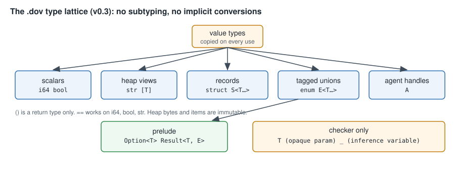
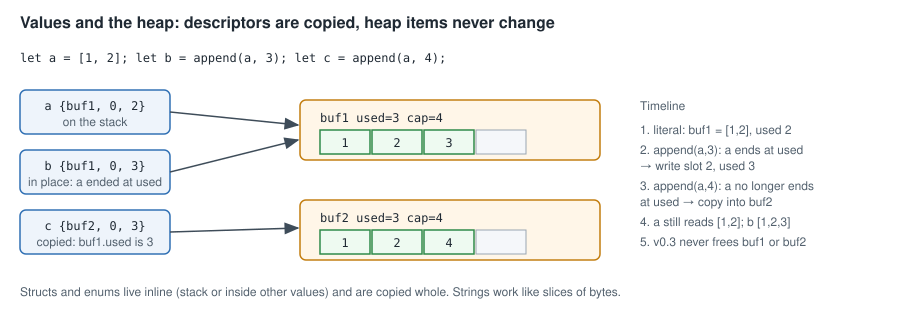
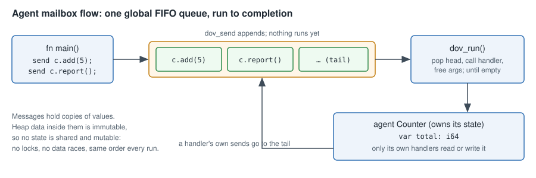
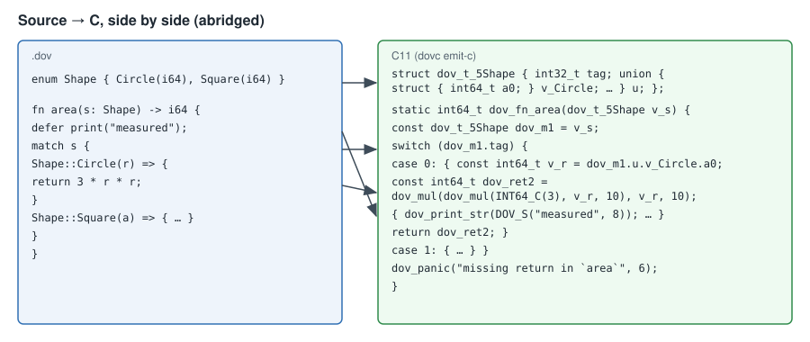
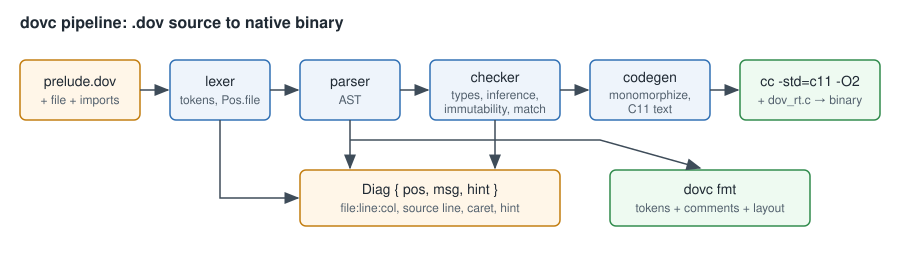

# .dov pLang — Architecture (v0.3)

This document explains why .dov exists, what the language is, and how `dovc` turns it into C.
The normative rules are in [SPEC.md](SPEC.md); the design reasons in [DESIGN.md](DESIGN.md).
Every number below comes from [`results/metrics.json`](../results/metrics.json).

Chapters: 1 Why .dov · 2 Grammar (EBNF) · 3 Types and immutability · 4 Ownership and values ·
5 The agent model · 6 C11 lowering, a worked example · 7 The compiler pipeline · 8 Diagnostics ·
9 Limits and roadmap

---

## 1. Why .dov

C and C++ give direct control and direct output, but three of their defaults cause most of the
bugs in concurrent systems code: mutable by default, shared memory between threads, and undefined
behavior on simple mistakes such as integer overflow or an out-of-range index.

.dov keeps the C output and the C interop, and flips those defaults:

- **Immutable by default.** `let` never changes. `var` must be written to allow change. Heap data
  (string bytes, slice items) never changes after it is made.
- **Agents, not threads.** State lives inside an `agent`. Other code reaches it only by `send`ing a
  message that holds copies of values. Nothing mutable is ever shared, so there are no data races
  and no locks.
- **No undefined behavior in the language core.** Overflow, division by zero and out-of-bounds
  indexes stop the program with a clear panic. There is no null: absence is `Option<T>`, failure is
  `Result<T, E>`.

The compiler emits readable C11 that any C compiler builds, and `extern "C"` calls libc or any C
library directly. The compiler is Rust with zero crate dependencies.

## 2. Grammar (EBNF)

The full grammar is in [SPEC.md §2](SPEC.md#2-grammar-ebnf); this is its outline.

```ebnf
program   = item* EOF ;
item      = fn_decl | extern_decl | agent_decl | struct_decl | enum_decl | import ;
fn_decl   = "fn" IDENT tparams? params ("->" type)? block ;
struct_decl = "struct" IDENT tparams? "{" fields "}" ;
enum_decl = "enum" IDENT tparams? "{" variant ("," variant)* ","? "}" ;
agent_decl= "agent" IDENT "{" (field | handler)* "}" ;
type      = "i64" | "bool" | "str" | "(" ")" | "[" type "]" | IDENT ("<" type ("," type)* ">")? ;
stmt      = let | assign | if | while | return | send | match | defer | expr ";" ;
expr      = precedence climbing over || && == != < <= > >= + - * / % and unary - ! ;
postfix   = primary ( "." IDENT | "[" expr "]" | "[" expr ".." expr "]" )* ;
```

The parser is hand-written recursive descent (`parser.rs`). One context flag handles the classic
ambiguity of `if x { … }` versus a struct literal `x { … }`: in the head of `if`, `while` and
`match`, a `{` after a name always starts the block.

## 3. Types and immutability



There is no subtyping and no implicit conversion. Two types are equal when their names and type
arguments are equal. The checker (`check.rs`) works in two passes:

1. **Declarations.** It registers every struct, enum and agent name first, so any type can mention
   any other. It resolves every written type, checks arity (`Option<i64>`, not `Option`), rejects a
   struct or enum that contains itself by value, and records function signatures.
2. **Bodies.** Each body is checked once. Expressions are checked against an *expected type*
   (from an annotation, a parameter, a return type, a field), and unknown types become inference
   variables that are solved by unification. At the end of each body every variable must be
   solved, or the error says which expression needs an annotation.

Generic bodies are checked once with their type parameters opaque, so a generic function cannot
use an operator on a `T`. Each call records its solved type arguments (`Info.targs`) for codegen.

Immutability is checked at every assignment. The root of an assignment target (`x` in `x.f.g = v`)
must be a `var` binding or a `var` field of the current agent. Parameters, `let` bindings,
`let` fields and `match` bindings cannot be assigned, and slice or string items never can. Each
`let` is also emitted as a C `const` object, so the C compiler checks the rule a second time.

`match` is checked for exhaustiveness (every variant, or `_`; `true` and `false`; `_` for `i64` and
`str`) and for unreachable arms. A `match` whose arms all return counts as returning.

## 4. Ownership and values



.dov has no borrow checker because it does not need one for safety in v0.3:

- Every value is **copied** on assignment, on a call and into a message. Structs and enums are plain
  C values and are copied whole.
- A `str` or a slice is a small descriptor (`{pointer, length}` / `{buffer, offset, length}`) that
  points at heap data. That heap data is **immutable** after it is written and is **never freed**
  in v0.3. So copying a descriptor is always safe: no one can change or free what it sees.
- `append(xs, x)` is amortized O(1). When `xs` ends exactly where its buffer's written items end,
  the new item goes into the next free slot. No existing view can reach that slot, so no visible
  value changes. Otherwise the items are copied to a new buffer. A range `xs[a..b]` shares the
  buffer and copies nothing.

The cost is memory: long-running programs grow. Region- or reference-counted freeing is on the
roadmap (chapter 9); because the data is immutable, adding it will not change program meaning.

## 5. The agent model



An `agent` declares fields and handlers. `spawn A` allocates one and runs its field initializers.
`send h.m(args);` copies the arguments into a message and appends it to the **single global FIFO
queue**; it never runs the handler. After `main` returns, the runtime pops messages one at a time
and runs each handler to completion. A handler's own sends go to the end of the queue.

Consequences:

- Handlers never run at the same time, so an agent's fields need no lock.
- No two agents share mutable state: a message holds copies, and heap data inside is immutable.
- The same program with the same input prints the same output in the same order.

The runtime is one thread, so the generated programs are data-race free by construction. CI also
builds the four agent examples with `-fsanitize=thread` and checks their output
(`make tsan`, `agent_examples_pass_thread_sanitizer`). A multi-threaded scheduler is later work; the
language rules above were chosen so that it can be added without changing program meaning.

## 6. C11 lowering, a worked example



Input:

```dov
enum Shape {
    Circle(i64),
    Square(i64),
}

fn area(s: Shape) -> i64 {
    defer print("measured");
    match s {
        Shape::Circle(r) => {
            return 3 * r * r;
        }
        Shape::Square(a) => {
            return a * a;
        }
    }
}

fn main() {
    let x = area(Shape::Circle(2));
    print(x);
}
```

Output of `dovc emit-c` (prelude items that are not used are left out of the C):

```c
typedef struct dov_t_5Shape dov_t_5Shape;
struct dov_t_5Shape { /* Shape */
    int32_t tag;
    union {
        struct { int64_t a0; } v_Circle;
        struct { int64_t a0; } v_Square;
    } u;
};
DOV_UNUSED static int64_t dov_fn_area(dov_t_5Shape v_s);
DOV_UNUSED static void dov_fn_main(void);
static int64_t dov_fn_area(dov_t_5Shape v_s) {
    (void)v_s;
    {
        const dov_t_5Shape dov_m1 = v_s;
        (void)dov_m1;
        switch (dov_m1.tag) {
        case 0: {
            const int64_t v_r = dov_m1.u.v_Circle.a0;
            (void)v_r;
            {
                const int64_t dov_ret2 = dov_mul(dov_mul(INT64_C(3), v_r, 10), v_r, 10);
                {
                    (void)((dov_print_str(DOV_S("measured", 8)), dov_print_nl()));
                }
                return dov_ret2;
            }
            break;
        }
        case 1: { /* same shape as case 0 */ }
        }
    }
    {
        (void)((dov_print_str(DOV_S("measured", 8)), dov_print_nl()));
    }
    dov_panic("missing return in `area`", 6);
}
static void dov_fn_main(void) {
    const int64_t v_x = dov_fn_area(((dov_t_5Shape){ .tag = 0, .u.v_Circle = { .a0 = INT64_C(2) } }));
    (void)v_x;
    (void)((dov_print_i64(v_x), dov_print_nl()));
}
```

What to notice:

- **Enum → tagged union.** The tag is the variant index; each payload variant is a union member.
  The type name `dov_t_5Shape` is a length-prefixed mangling, so generic instances such as
  `Option<[i64]>` get unique names (`dov_t_6OptionISlE`).
- **`match` → `switch`.** The scrutinee is evaluated once into a `const` temporary. Each binder
  becomes a `const` local read from the payload.
- **`defer`.** The return value is computed into `dov_ret2` first, then every active deferred
  block runs (innermost and latest first), then the function returns. The fall-through copy at the
  end handles leaving the block normally.
- **Checked arithmetic.** `*` becomes `dov_mul(a, b, line)`, an inline function in `dov_rt.h` that
  panics on overflow with the source line. Index and range operations call similar inline checks.
- **Strict C.** `(void)x;` lines and `DOV_UNUSED` keep `-Wall -Wextra -Werror` quiet for code that
  is legal .dov but unused. Every golden program's C is built that way, and with ASan/UBSan.

Generic functions are emitted once per concrete instance: `first<i64>` becomes `dov_fn_first__l`,
`first<str>` becomes `dov_fn_first__s`. Codegen keeps a work queue of instances that the reachable
code calls, starting from every non-generic function and handler.

## 7. The compiler pipeline



| Stage | File | Job |
|---|---|---|
| Load | `lib.rs` | prelude (file 0), the main file (file 1), then each import once (by canonical path) |
| Lex | `lexer.rs` | tokens with `Pos { file, line, col }`; comments kept for the formatter |
| Parse | `parser.rs` | recursive descent to the AST (`ast.rs`); layout facts for `fmt` |
| Check | `check.rs` | declarations, types, inference, generics, exhaustiveness, immutability |
| Codegen | `codegen.rs` | monomorphization, type definitions in dependency order, C11 text |
| Build | `lib.rs` | write `prog.c` + `dov_rt.{h,c}`, run `$CC -std=c11 -O2` |
| Format | `fmt.rs` | token-stream layout; re-lexes its output to prove nothing changed |

Imports merge all items into one namespace. Each item keeps the file id in its positions, so a
diagnostic in an imported file names that file. Measured compile speed of the front end plus C
generation is in the README table (`bench/run.py`, a generated 10,000-line program).

## 8. Diagnostics

Every error is a `Diag { pos, msg, hint }`. The renderer prints the classic `file:line:col:` head
that editors parse, then the source line, a caret under the column (tabs kept so it lines up) and
a one-line hint:

```text
tests/golden/fail/struct_assign_field_of_let.dov:7:5: error: cannot assign to a field of immutable binding `p`
  |
7 |     p.x = 2;
  |     ^
  = hint: declare it with `var p` instead of `let p` to allow mutation
```

Unknown names get a "did you mean" hint (edit distance ≤ 2). Every error kind has a golden test in
`tests/golden/fail/` whose `.err` file holds the exact output; the harness also checks that every
diagnostic has a position, a caret and a hint. `dovc` reports the first error only.

## 9. Limits and roadmap

Limits of v0.3 (see [SPEC.md §16](SPEC.md#16-known-limits-v03)):

- heap data and agents are never freed;
- no methods, traits, closures, nested patterns, `for`, `break` or `continue`; `match` is a statement;
- `==` only on `i64`, `bool`, `str`;
- imports share one namespace (no qualified names yet);
- one scheduler thread;
- the first error only.

Roadmap ([MASTERPLAN.md](MASTERPLAN.md)): memory reclamation that keeps the immutable-heap rule,
a multi-threaded agent scheduler with the same message semantics, qualified module names,
methods and traits, `for` loops, and more than one diagnostic per run.
